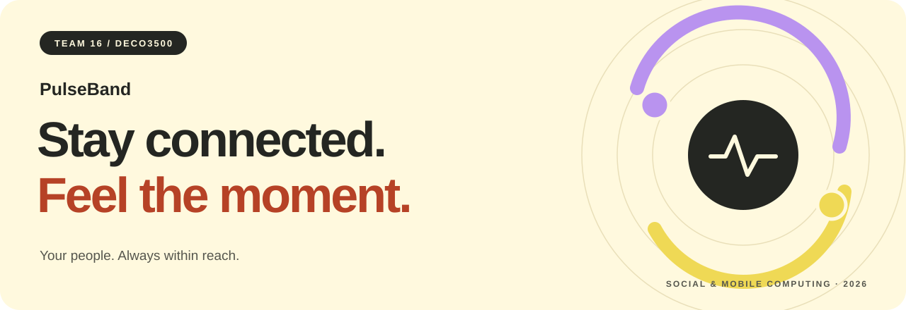
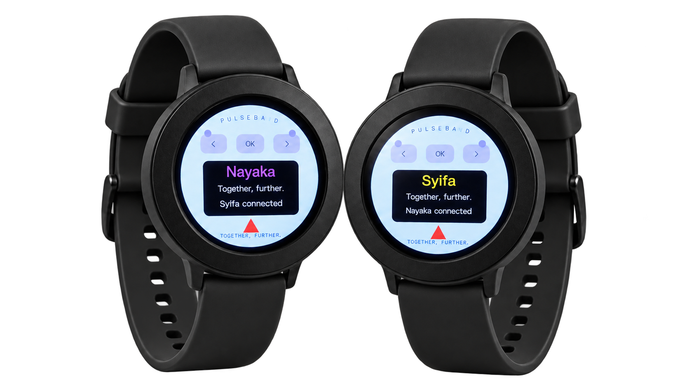
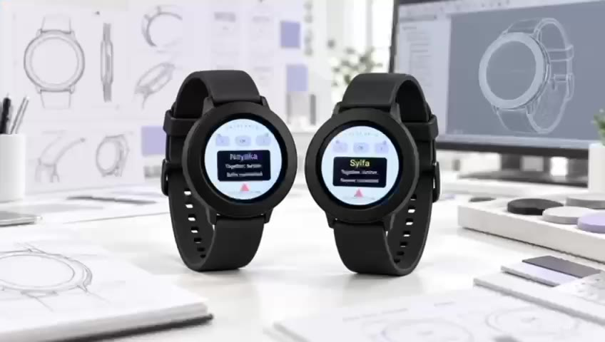
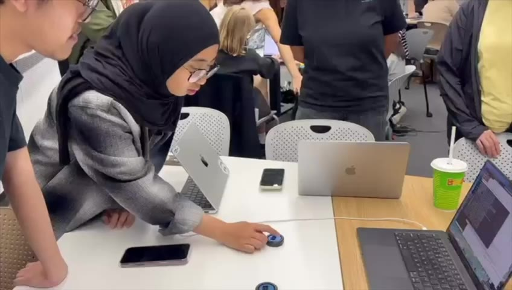
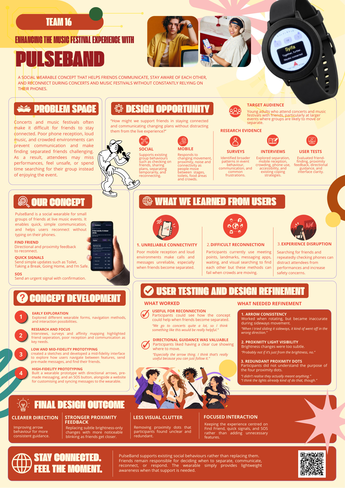
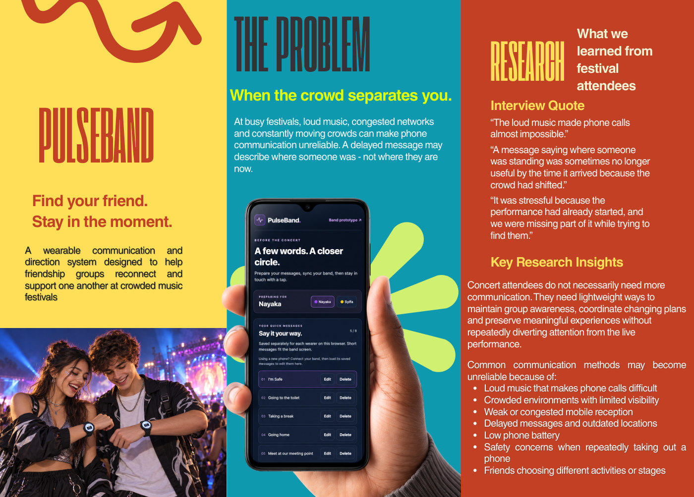
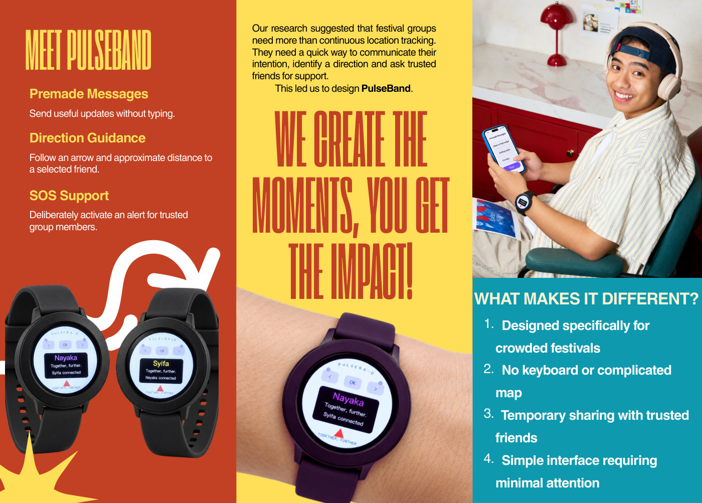
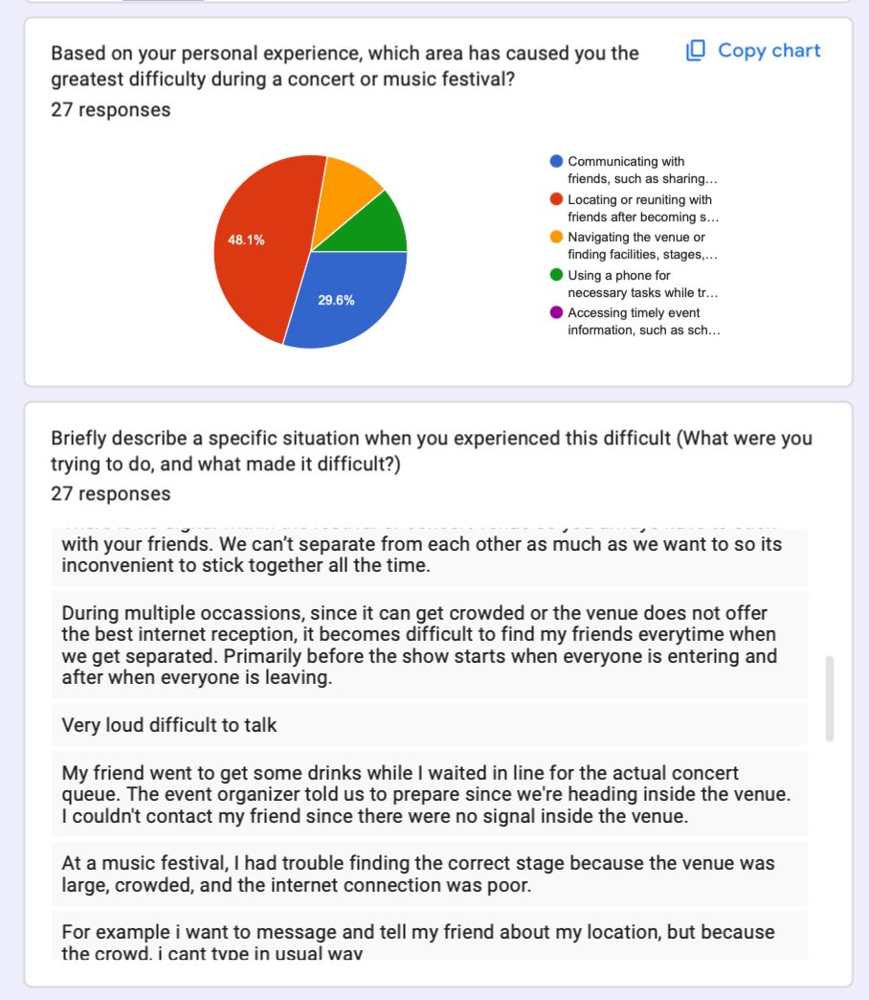

<p align="center">
  
</p>

<h1 align="center">PulseBand</h1>

<p align="center">
  A social wearable concept that helps friends communicate, reconnect and stay aware of each other at concerts and music festivals.
</p>

<p align="center">
  <a href="https://deco-3500-website-promo.vercel.app/"><strong>Explore the website ↗</strong></a> ·
  <a href="https://pulseband-steel.vercel.app/">Try the web prototype</a> ·
  <a href="https://github.com/terserahdehh/DesignProposal---DECO3500/wiki">Project wiki</a> ·
  <a href="#videos">Watch the videos</a> ·
  <a href="#poster-and-brochure">Poster &amp; brochure</a>
</p>

<p align="center">
  
</p>

## Your people. Always within reach.

Concerts are loud, crowds keep moving, and phone messages can arrive too late. Finding a separated friend can mean missing the performance you came to enjoy together.

**PulseBand explores a simpler way to stay connected without constantly checking your phone.** Prepare short messages before the event, send a signal from your wrist, and use friend-finding cues when you want to reconnect.

| Find Friend | Quick Signals | SOS |
| --- | --- | --- |
| Choose a friend and follow directional and proximity cues to reconnect. | Send a prepared update with a few taps: **Toilet**, **Taking a Break**, **Going Home**, **I'm Safe**. | Deliberately confirm an urgent signal to your connected friend. |

### A few taps. A closer friend.

**Select a friend → Follow the direction cue → Notice proximity feedback → Reconnect.**

Typing and message customisation happen before the event on the [companion page](https://pulseband-steel.vercel.app/phone), keeping the wrist interaction focused on the moment.

## Videos

<table>
  <tr>
    <th width="50%">See PulseBand in the moment</th>
    <th width="50%">Usability testing</th>
  </tr>
  <tr>
    <td>
      <a href="promotional-materials/videos/pulseband-promo.mp4"></a>
    </td>
    <td>
      <a href="promotional-materials/videos/usability-testing.mp4"></a>
    </td>
  </tr>
  <tr>
    <td><strong>Promotional video · 0:59</strong><br>Meet the concept and see the wearable experience.<br><a href="https://deco-3500-website-promo.vercel.app/#videos">Watch on the website ↗</a> · <a href="promotional-materials/videos/pulseband-promo.mp4">Open MP4 on GitHub</a></td>
    <td><strong>Usability testing · 1:15</strong><br>See people try the friend-finding interaction.<br><a href="https://deco-3500-website-promo.vercel.app/#testing">Watch on the website ↗</a> · <a href="promotional-materials/videos/usability-testing.mp4">Open MP4 on GitHub</a></td>
  </tr>
</table>

### Tested with people. Refined through feedback.

**[Read the usability-testing transcript (PDF)](research-findings/team/usability-testing-transcript.pdf)** · 3 pages

Five participants tested friend-finding and proximity interactions, as summarised on the [promotional website](https://deco-3500-website-promo.vercel.app/#testing). Feedback highlighted three priorities:

| What participants noticed | Design direction |
| --- | --- |
| Directional guidance was useful, but sideways movement could make it inconsistent. | Make direction feedback more consistent. |
| Brightness changes were too subtle to notice. | Explore more noticeable proximity cues, including faster blinking. |
| The four proximity dots were unclear and redundant. | Simplify the display and remove unnecessary indicators. |

These findings guide refinement; the videos and poster do not establish reliable positioning in festival crowds. Read the [evaluation and iteration record](https://github.com/terserahdehh/DesignProposal---DECO3500/wiki/Evaluation-and-Iteration) for evidence, implementation status and further testing.

## Poster and brochure

Open either preview to read the original PDF. Both brochure pages are shown below.

<table>
  <tr>
    <th width="40%">A2 poster</th>
    <th width="60%">PulseBand brochure</th>
  </tr>
  <tr>
    <td valign="top">
      <a href="promotional-materials/documents/pulseband-a2-poster.pdf"></a>
    </td>
    <td valign="top">
      <a href="promotional-materials/documents/pulseband-brochure.pdf"></a><br>
      <a href="promotional-materials/documents/pulseband-brochure.pdf"></a>
    </td>
  </tr>
  <tr>
    <td><a href="promotional-materials/documents/pulseband-a2-poster.pdf"><strong>Read the A2 poster PDF ↗</strong></a><br>1 page · portrait</td>
    <td><a href="promotional-materials/documents/pulseband-brochure.pdf"><strong>Read the brochure PDF ↗</strong></a><br>2 pages</td>
  </tr>
</table>

All original videos, PDFs and previews are organised in **[promotional-materials/](promotional-materials/README.md)**.

## Explore the prototype

| Experience | Open it |
| --- | --- |
| Promotional website | [Discover the problem, features, videos and team](https://deco-3500-website-promo.vercel.app/) |
| Interactive web prototype | [Try the wearable interface and simulator](https://pulseband-steel.vercel.app/) |
| Physical-band companion | [Prepare messages and connect a band](https://pulseband-steel.vercel.app/phone) |
| Physical demo setup | [Quick start](hardware/QUICK_START.md) · [Syifa's laptop setup](hardware/CONNECT_SYIFA.md) · [Hardware guide](hardware/README.md) |

**Current prototype scope.** The physical build connects two configured bands, **Nayaka and Syifa**, for direct peer messages. Direction is approximate guidance from two independently shared phone locations; the bands have no GPS, wrist compass or vibration motor. The original web simulator uses simulated proximity and direction. Physical SOS uses three separate OK confirmations and alerts the paired friend. The [usage guide](https://github.com/terserahdehh/DesignProposal---DECO3500/wiki/Prototype-and-Usage-Guide) explains each demonstration mode.

### Run locally

```bash
cd prototype
npm ci
npm run web
```

Open the local URL printed by Expo. For tests, transport details and redeploying the existing Vercel project, use the **[development and deployment guide](docs/DEVELOPMENT.md)**. The original detailed README instructions are preserved there.

## Research interviews

**[Read all interview transcripts (PDF)](research-findings/interview-transcripts.pdf)** · 4 interviews · 23 pages

Our interviews are collected in one document, covering communication, friend separation, phone use and accessibility at live music events. Explore the [research findings](research-findings/README.md) for the synthesis and evaluations.

### Google Forms survey evidence

Our survey received **27 responses**. In the chart, **48.1%** selected locating or reuniting with friends as their greatest difficulty, while **29.6%** selected communicating with friends.

<p align="center">
  
</p>

## Design journey and project wiki

| Explore | What you will find |
| --- | --- |
| [Wiki home](https://github.com/terserahdehh/DesignProposal---DECO3500/wiki) | Project overview and navigation |
| [Design process](https://github.com/terserahdehh/DesignProposal---DECO3500/wiki/Design-Process-Overview) | How the concept evolved from research to wearable |
| [Research and insights](https://github.com/terserahdehh/DesignProposal---DECO3500/wiki/Research-and-Insights) | Combined interview transcripts, findings and source evidence |
| [Experience requirements](https://github.com/terserahdehh/DesignProposal---DECO3500/wiki/Experience-Requirements) | Research translated into design priorities |
| [Prototype and usage](https://github.com/terserahdehh/DesignProposal---DECO3500/wiki/Prototype-and-Usage-Guide) | Web and physical demonstrations, setup and scope |
| [Evaluation and iteration](https://github.com/terserahdehh/DesignProposal---DECO3500/wiki/Evaluation-and-Iteration) | User feedback, refinements and engineering checks |
| [Promotional materials](https://github.com/terserahdehh/DesignProposal---DECO3500/wiki/Promotional-Materials) | Website, both videos, poster and brochure |
| [Ethical considerations](https://github.com/terserahdehh/DesignProposal---DECO3500/wiki/Ethical-Considerations) | Location, consent, accessibility and peer alerts |
| [Progress records](https://github.com/terserahdehh/DesignProposal---DECO3500/wiki/Standup-and-Progress-Records) | Project snapshots and team records |
| [Tradeshow and submission](https://github.com/terserahdehh/DesignProposal---DECO3500/wiki/Tradeshow-and-Submission) | Visitor scenario and submission preparation |

## Inside this repository

| Folder | Contents |
| --- | --- |
| [`prototype/`](prototype/) | Interactive Expo / React Native web prototype and companion page |
| [`hardware/`](hardware/) | ESP32 firmware, bridge, setup and verification guides |
| [`research-findings/`](research-findings/README.md) | Combined interview PDF, research synthesis, evaluations and shared research |
| [`promotional-materials/`](promotional-materials/README.md) | Promotional and usability videos, poster, brochure and visual assets |
| [`docs/`](docs/DEVELOPMENT.md) | Detailed development, testing and deployment instructions |

## Team 16

**DECO3500 · Social & Mobile Computing · The University of Queensland · 2026**

- Andhika Nayaka Arya Wibowo
- Serafina Nala Putri Setiawan
- Syifa Ananda Widyati
- Nguyen Minh Thao Vy

<p align="center"><strong>Bringing friends closer, one pulse at a time.</strong></p>
