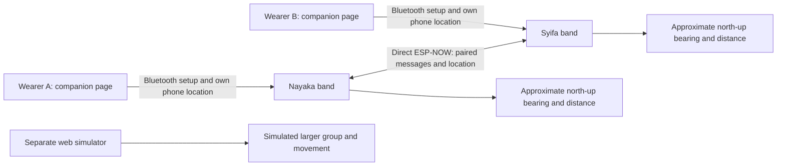

# Prototype scope and social interaction framework

This is the assessment-facing scope of the current artefacts. Read alongside the [experience requirements](https://github.com/terserahdehh/DesignProposal---DECO3500/wiki/Experience-Requirements), [research](../research-findings/README.md) and [hardware guide](../hardware/README.md).

## Data and interaction flow

Each wearer supplies a location from their own device. Two bands receiving one laptop's position cannot locate two independently moving people. Location expires after 60 seconds; no location history is saved in band flash. Prepared text is persistent. Browser identity and messages use local storage. Device names are demonstration labels, not authenticated accounts.

## Functionality boundaries

| Artefact / feature | Actual function | Limit or simulation |
| --- | --- | --- |
| Two physical bands | Bidirectional ESP-NOW messaging, sender identification and device acknowledgement | One configured Nayaka–Syifa pair; no demonstrated larger physical group |
| `/phone` companion | Edit text, connect a supported band, manually sync/read acknowledged presets, share device location | Supported browser and hardware required; no secure account identity |
| Image editor | Browser image creation, preview and storage; protocol support checks | Documented installed watches are text-only; do not infer physical image support from UI tests |
| Find Friend | Approximate bearing and metres from independent fresh coordinates; uncertainty gating | No onboard GPS, magnetometer, obstacle-aware route, indoor positioning or wrist-relative compass |
| SOS | Three confirmations, cancellation before sending, paired-friend alert | No staff integration, rescue service, read receipt or guaranteed delivery |
| Original `/` simulator | Interactive screens, selection, larger group and incoming state exploration | Direction, proximity, battery and group delivery are simulated |
| Browser connection panel | Real WebRTC peer messaging with manual invitation/reply | Network connectivity required; one peer; restrictive NAT may prevent connection |
| Automated tests | Interface state, protocol, acknowledgement, errors and WebRTC checks | Browser hardware doubles do not validate live radios, location accuracy or people |
| Physical usability session | Five participants' qualitative feedback on Find Friend | No reported task completion times, controlled accuracy benchmark or festival field validation |

## Applying the social-wearables framework

Dagan et al. (2019) consider input, intentionality, output perception and the social effects of wearables. The team's [supplied framework image](assets/social-wearables-framework.png) is included with attribution in the [process overview](wiki/Design-Process-Overview.md). We apply its questions as follows:

| Framework question | Current PulseBand behaviour | Design implication |
| --- | --- | --- |
| Who triggers the input? | A wearer deliberately selects and confirms a prepared message. Each wearer starts their own phone-location sharing. | Name the acting wearer and recipient, and make cancellation available. |
| How intentional is activation? | Sending is deliberate. Location updates continue automatically after sharing starts, until stopped or interrupted. | A one-time permission gesture should not be mistaken for consent to every future finding request. |
| Who perceives the output? | The receiving wearer sees the message and sender. A bystander may also see a lit wrist display. | Consider legibility alongside privacy and avoid treating the display as a confidential channel. |
| Who can stop or decline? | Sharing can be stopped through the companion, but the watch does not ask for permission for each Find Friend request. | Per-request refusal remains a design priority. |
| What social value is added? | Brief messages and approximate guidance aim to support awareness, coordination and reconnection. | Evaluate mutual understanding and freedom to separate, rather than count device receipt as successful coordination. |

The framework focuses on co-located social interaction. Applying it to temporary separation within a shared festival venue is our interpretation, not evidence of equivalent results. [The literature synthesis](../research-findings/literature-and-frameworks.md) also connects this account to re-planning, shareability and Bluetooth-based festival observations.

## Applying the groupware perspective

Ellis et al. (1991) identify communication, collaboration and coordination as central groupware concerns. We use that perspective to interpret our own design:

| Social/mobile concept | PulseBand design consequence | Remaining question |
| --- | --- | --- |
| Communication | Name sender/recipient; acknowledge device receipt | Did the friend read and understand the update? |
| Coordination | Prepare messages with an intended action; retain agreed landmarks | Who waits, who moves, and how is agreement confirmed? |
| Collaboration | Both friends participate in reuniting and decide how to respond | How is coordination effort shared rather than assigned to one organiser? |
| Awareness | Show peer status and location quality with the cue | Does visible status encourage pressure to remain available? |
| Time and place | Friends may be separated while reading updates asynchronously | How quickly does a cue lose meaning when crowds move? |
| Location | Suppress a bearing when reported uncertainty dominates separation | Do people understand north up and the absence of routing? |

This explicit application is a present-day analytical explanation, not evidence that this exact table was produced in Week 8 or Week 9.

## References

Dagan, E., Márquez Segura, E., Altarriba Bertran, F., Flores, M., Mitchell, R., & Isbister, K. (2019). Design framework for social wearables. In *Proceedings of the 2019 on Designing Interactive Systems Conference* (pp. 1001–1015). Association for Computing Machinery. https://doi.org/10.1145/3322276.3322291

Ellis, C. A., Gibbs, S. J., & Rein, G. (1991). Groupware: Some issues and experiences. *Communications of the ACM, 34*(1), 39–58. https://doi.org/10.1145/99977.99987
