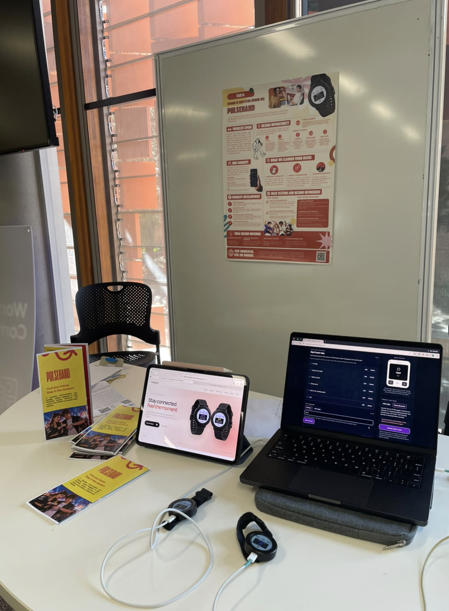
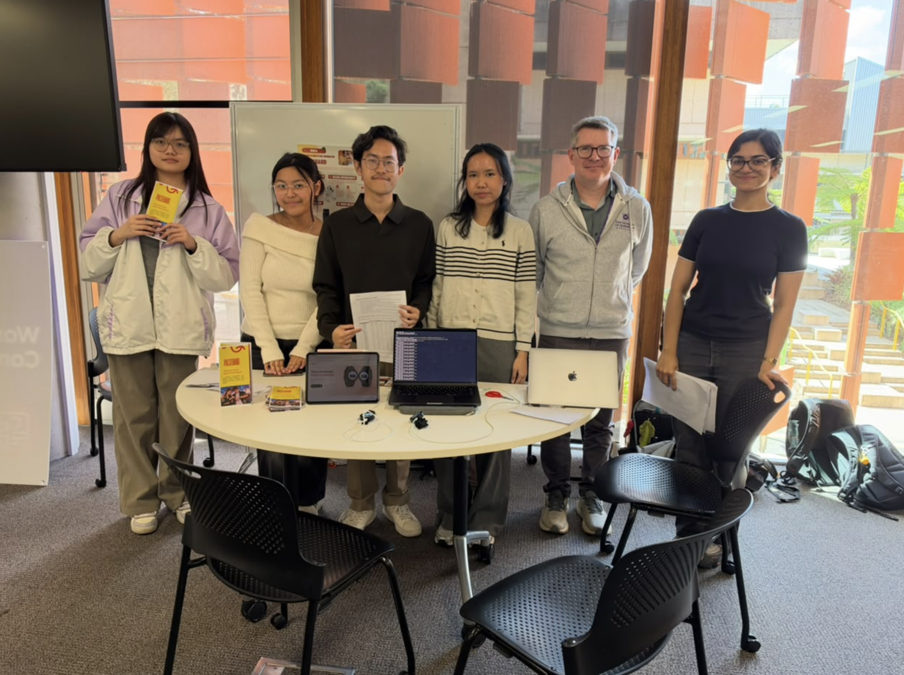

# PulseBand exhibition photographs

These images were supplied by the team as screenshots saved on 25 October 2026. The screenshot creation date is not asserted to be the date of the exhibition. The source files are preserved without retouching or generated additions.

| File | What the image documents |
| --- | --- |
| [Exhibit setup](exhibit-setup.png) | The PulseBand poster, printed brochures, tablet showing the promotional website, laptop showing the companion interface and two physical boards on the demonstration table |
| [Exhibition group photograph](exhibit-group.png) | A group gathered at the PulseBand display, with the poster, promotional materials, devices and laptops visible |

*Team-supplied screenshot of an exhibition photograph. The image documents the arrangement of the display and artefacts.*

*Team-supplied exhibition group photograph. No individual is identified by appearance, and no assessment result is inferred from the image.*

These photographs add visual evidence to the team's account of its Week 12 exhibit. They are not task-success measurements or a recording of the oral pitch. See the [Design Process Overview](../../docs/wiki/Design-Process-Overview.md), [exhibit pitch and visitor flow](../../docs/EXHIBIT-PITCH.md), and [wiki progress records](https://github.com/terserahdehh/DesignProposal---DECO3500/wiki/Standup-and-Progress-Records) for context. The team should retain any agreed publication permissions privately.
