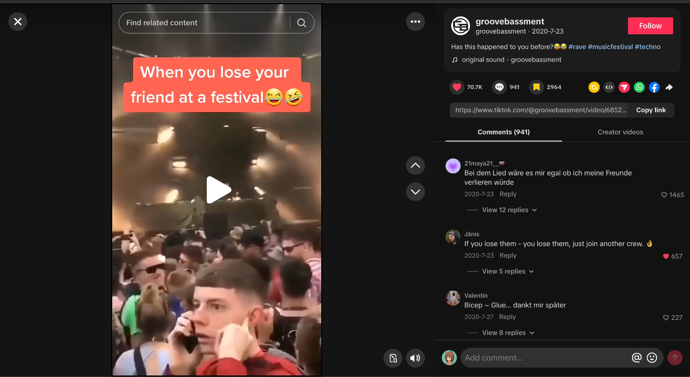
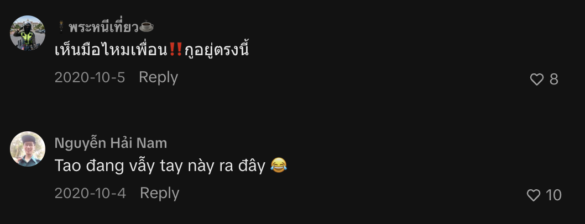
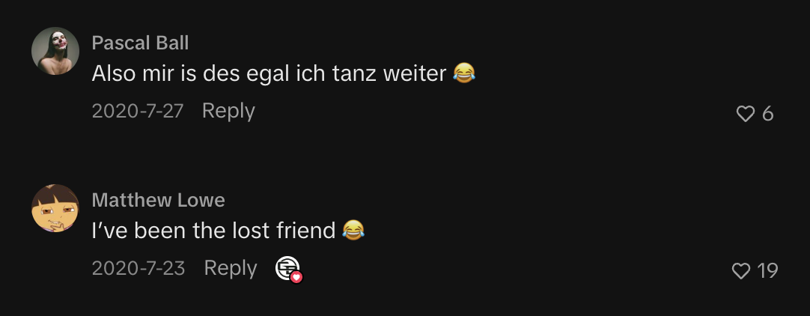
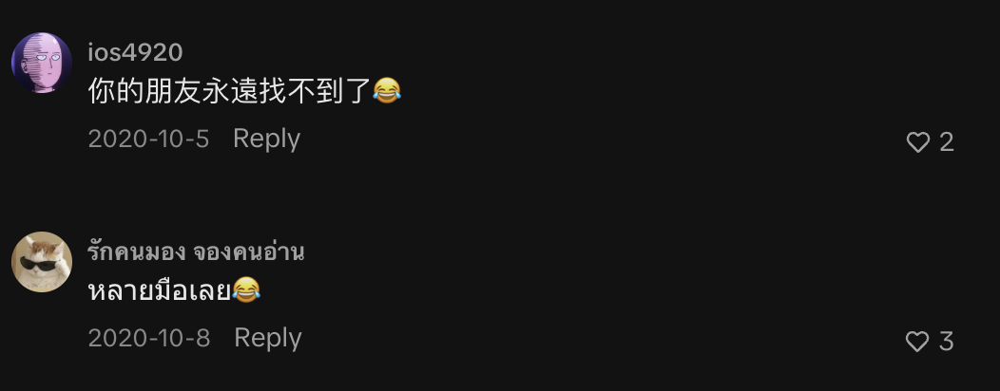
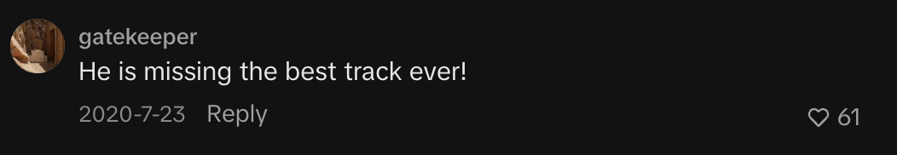
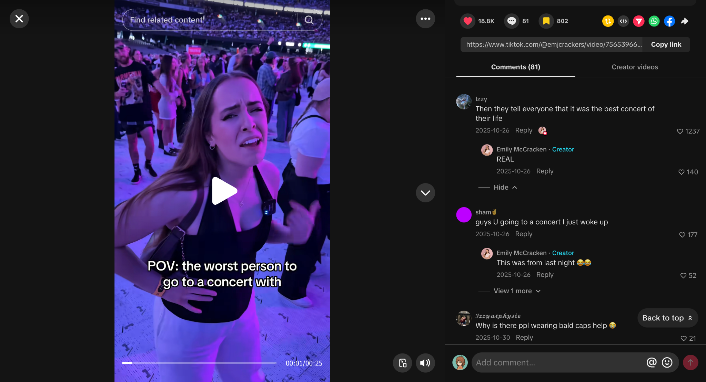

# Team research notes

[Download the original Word document](Team%20Research%20Tasks.docx)

### Nayaka

#### 1. Netnography

a. Reddit - Finding friends without cell servicehttps://www.reddit.com/r/aves/comments/11ewu0u/finding_people_at_raves_when_theres_no_cell/People discuss how difficult it is to find friends at festivals when phone signal is poor. Some use meeting points as a backup.

b. Reddit - Too much phone use to find friendshttps://www.reddit.com/r/aves/comments/1pglwa1/unpopular_opinion_i_hate_having_to_spend_so_much/People mention that constantly checking their phone to find friends can distract them from enjoying the festival.

#### 2. Secondary Research

a. Touching the Audience: Musical Haptic Wearables for Live Music Performanceshttps://link.springer.com/article/10.1007/s00779-020-01395-2This study explores wearable haptic devices during live music. It shows that vibration can improve engagement, but users should be able to adjust or turn it off because not everyone finds it comfortable.

#### 3. Interview Analysis

#### Main Findings

- Poor phone reception is the biggest problem when trying to contact friends.

- Crowded spaces make it difficult to move around and find separated friends.

- Loud music makes communication harder, especially for someone who is hard of hearing.

- The participant prefers simple navigation and physical signage when event maps are confusing.

- Haptic vibration may be useful, but it should be optional and adjustable.

- Staying connected with friends is more important than adding extra entertainment features.

#### Behaviours

- Usually attends concerts with friends.

- Uses WhatsApp or LINE to communicate.

- Uses meeting points when the group separates.

- Brings a power bank, so battery is not a major concern.

- Uses the phone frequently to record performances.

- Turns hearing technology off during very loud concerts because the sound can become too intense.

#### Pain Points

- Weak signal when separated from friends.

- Difficulty knowing whether friends are still waiting or have moved somewhere else.

- Crowds make finding people physically difficult.

- Calling someone's name is unreliable in loud environments.

- Confusing venue maps make navigation difficult.

- Continuous vibration could become uncomfortable.

#### Concerns

- Haptic features should not assume all hard-of-hearing users have the same needs.

- Users need control over vibration strength and the option to turn it off.

- Friend-finding features should still be useful when normal mobile reception is poor.

- Navigation should be simple and easy to understand.

#### Interesting Quotes

“Poor phone reception and crowded spaces are probably the two main issues for me.”

“If someone is trying to call my name from far away during a concert, I may not hear them.”

“If I hadn't walked past that entrance or hadn't seen them there, it could have been a very different situation.”

“Users should be able to adjust [the vibration] like a volume button on devices.”

“I think improving signals or reception... would make it easier to connect to others or access information that we need.”

#### Possible Affinity Map Themes

Connection: poor reception, separation, meeting pointsAccessibility: hearing difficulty, loud environment, adjustable hapticsNavigation: confusing maps, physical signageUser Control: vibration intensity, on/off controlPriority: reliable communication and friend-finding

### Serafina

#### 1. Netnography

- Reddit: Worst Concert Experience https://www.reddit.com/r/Concerts/comments/1g4jyj5/name_your_worst_concert_experiences/

- Reddit: Concerts are weird now https://www.reddit.com/r/indieheads/comments/10n9aql/youre_not_getting_old_concerts_are_weird_now/

#### 2. Secondary Research

- The Role of Mobile Applications in the Consumer Experience at Music Festivals The Role of Mobile Applications in the Consumer Experience at Music Festivals

#### 3. Interview Analysis

- Main Findings

• Communication and coordination are more difficult at festivals than at smaller concerts. At concerts, the participant usually stays in one place with their friends. At festivals, people move between different stages and are more likely to become separated.

• Poor phone reception was the participant’s main frustration. It prevented them from calling or messaging their friends when separated.

• The participant and their friends use a fixed meeting point as a workaround. Before someone leaves, the group agrees to remain in the same location until they return.

• Staying with friends is also associated with safety. The participant avoids separating from the group because they are concerned that they may not be able to find each other again.

• The participant tries to remain present during performances and limits their phone use. Their phone is mainly used to record videos rather than browse or message.

• Real-time event information is important, particularly when an artist is delayed or cancels. The participant wants to know whether the following performances will start earlier, later, or remain unchanged.

• When asked how communication could work without constantly checking a phone, the participant suggested something wearable. They explained that concert attendees carry as little as possible, venues often restrict bag sizes, and small objects can easily be lost.

• The participant preferred subtle communication methods, such as approximate friend location, proximity indicators, or simple symbols. They did not want alarms or signals that could distract people from the performance.

- Behaviours

• Attends concerts and festivals with friends.

• Travels to the venue and enters the event with the group.

• Stays in one location during smaller concerts.

• Uses a predetermined meeting point when someone leaves the group.

• Sometimes continues enjoying a festival separately when communication is impossible.

• Use the toilet before a concert to avoid losing their position.

• Moves towards the back when they need a quieter or less crowded area.

• Uses their phone mainly to record videos.

• Tries to avoid checking their phone during performances.

• Look for other people to stay with when attending alone because it feels safer.

- Pain Points

• Poor or unavailable mobile reception.

• Difficulty contacting and locating separated friends.

• Time spent trying to reunite with friends.

• Fear of not being able to find the group again.

• Unclear information about artist cancellations and schedule changes.

• Uncertainty about whether to remain in the crowd or leave.

• Difficulty seeing the stage because of taller attendees.

• Risk of losing belongings when repeatedly opening a small bag.

• Losing a good position when leaving to use the toilet.

• Feeling unsafe when alone or separated from friends.

- Concerns

• Communication methods should not distract from the performance.

• Any additional object should be easy to carry and difficult to lose.

• Friend-location features should be limited to selected or linked friends.

• Signals should be simple, subtle, and understandable in a loud environment.

• Attendees should receive information about intense sound or sensory conditions before the event.

• Continuous vibration may not be suitable for every person or type of event.

- Interesting Quotes

“It’s always bad reception and you can’t get a hold of your friends.”

“You lose your friend, you’re not gonna find them again.”

“Good reception, please.”

“Usually me and my friends just have this one spot that we are in.”

“I’m very in the moment. And I try not to touch my phone.”

“When you go to concerts, you try to bring as little as possible.”

“I would preferably want something that I can wear.”

“Some sort of indicator that says, ‘Oh, your friend is near.’”

“Maybe we can send little signals to each other. Maybe the symbol means that.”

### Syifa

#### Netnography

- Reddit – Losing friends during festivals

https://www.reddit.com/r/aves/comments/17oi8bo/how_do_you_contact_your_missing_friend_in_a_rave/

People discuss how friends often become separated at festivals when group members move around independently, making it difficult to reconnect during the event.

- Reddit – Time spent trying to find friends

https://www.reddit.com/r/festivals/comments/15x7z0e/poll_per_festival_day_how_much_time_do_you/

Festival attendees may spend significant time trying to reconnect with friends through texting, checking their phones and moving through the crowd, which can take attention away from the festival experience.

#### 2.  Secondary Research

- The Role of Mobile Applications in the Consumer Experience at Music Festivals

https://www.ingentaconnect.com/content/cog/em/2015/00000019/00000001/art00003;jsessionid=80qae96ql8an5.x-ic-live-03#

This study explores smartphone use at music festivals. It found that attendees can experience difficulties such as poor phone signal, limited battery life, and becoming separated from friends, which can make communication and coordination during the festival more difficult.

#### 3. Interview Analysis

Main Findings

- Communication with friends is a major part of the concert experience, especially when people become separated.

- Poor phone reception can make communication unreliable in crowded indoor venues.

- Loud music makes face-to-face communication difficult even when friends are standing close together.

- Crowded standing areas can make movement difficult and physically uncomfortable.

- Using a phone can distract attention from the performance.

- Toilets can be difficult to access because of crowding, even when signs and facilities are available.

- Being separated from friends becomes more stressful when combined with poor signal and a crowded environment.

#### Behaviours

- Used WhatsApp to coordinate with a friend during the event.

- Waited for the friend because they had different queue numbers.

- Stood further back to visually look for the friend entering the venue.

- Used Do Not Disturb while recording to avoid interruptions.

- Borrowed a power bank from another attendee when the phone battery became low.

- Tapped the friend on the shoulder or shouted when communicating nearby.

- Relied on texting when separated.

- Looked for different toilets when the nearest ones were too crowded.

#### Pain Points

- Messages not being delivered because of poor reception.

- Difficulty finding a friend after being separated.

- Low phone battery during a long event.

- Difficulty hearing conversations because of loud music.

- Limited movement in a packed standing area.

- Phone notifications and messages distracting from the performance.

- Crowded toilets and having to search for alternatives.

- Depending on phone signal to communicate when separated.

#### Concerns

- The participant may panic if separated from a friend in a crowded place.

- Poor reception increases anxiety when they cannot locate their friend.

- Continuous vibration could become annoying or uncomfortable.

- The participant wants control over whether vibration is enabled and how strong it is.

- Communication becomes especially difficult when multiple issues happen together, such as crowding, loud music, and poor signal.

#### Interesting Quotes

- “I was waiting for her because I didn’t want to be separated from her.”

- “I stood a little further back so I could see the people coming in.”

- “The message didn’t come through because her signal was bad.”

- “I kept saying, ‘What? What? Huh?’ because I couldn’t hear her.”

- “It was really crowded, I couldn’t move much, and it felt kind of suffocating.”

- “Who knows what I could have seen on stage during that time?”

- “We would just text each other. But we would have to hope that the bad signal wouldn’t interfere.”

- “If I’m in a really crowded place with strangers and I can’t see my friend, I would panic.”

- “Having no signal at the same time would make me panic and freak out even more.”

Amy

- Netnography

Tiktok: “When you lose your friend at a festival”

https://www.tiktok.com/@groovebassment/video/6852336263920454918

Comment:

“เห็นมือไหมเพื่อน‼️กูอยู่ตรงนี้” “See my hand, friend?! I'm right here!”

“Tao đang vẫy tay này ra đây 😂” “I'm waving my hand over here 😂”

“Also mir is des egal ich tanz weiter 😂” “I don't care, I'll keep dancing 😂”

“你的朋友永遠找不到了😂” “Your friend is gone forever 😂”

“หลายมือเลย😂” “So many hands involved! 😂”

Observation:

Friends can easily become separated in large, crowded festival environments, making it difficult to reconnect.

Insight:

Group awareness becomes difficult when visual contact is lost. Festivalgoers need to know where their friends are and how to regroup, but conventional communication may not always suit a loud, crowded environment.

Friend separation → “I've been the lost friend” → “Your friend is gone forever”

Finding / signalling → “See my hand!” → “I'm waving!” → “So many hands!”

Experience disruption → “I'll keep dancing” → “He's missing the best track ever”

Then derive:

Finding 1: Separation is a relatable festival experience.

Finding 2: People improvise physical signals when trying to reconnect.

Finding 3: Signals become difficult to distinguish in crowded environments.

Finding 4: Searching for friends competes with enjoying the performance.

TikTok: “POV: the worst person to go to the concert with”

https://www.tiktok.com/@emjcrackers/video/7565396648436780309

Observation:

Going to a concert with someone whose behaviour, priorities, or expectations differ can negatively affect the experience.

Insight:

Concert experiences are socially interdependent. A person's enjoyment is affected not only by the event itself but also by how compatible and coordinated they are with their companions.

#### 2. Secondary Research

## The Role of Mobile Applications in the Consumer Experience at Music Festivals

DOI: 10.3727/152599515X14229071392909

Link: https://www.researchgate.net/publication/275414710_The_Role_of_Mobile_Applications_in_the_Consumer_Experience_at_Music_Festivals

It is a peer-reviewed journal article and directly studies music festival attendees and mobile applications, using focus groups with festivalgoers. The authors found that mobile technology plays a role in scheduling, communication, personalisation, and the overall festival experience; they also highlight practical constraints such as keeping phones charged.

Connect to interview/netnography findings: People depend on phones to communicate and coordinate with friends, but this becomes problematic when they are separated, connectivity is poor, or phones are unavailable.

Academic evidence: Festival apps and smartphones can support the attendee experience, but designs need to respond to festivalgoers' actual experiential and coordination needs rather than simply adding more features.

### Interview 1: Dai

Include direct evidence quotes under your findings. In affinity mapping, interview extracts can be placed on sticky notes and grouped into themes, ensuring your interpretations remain grounded in the participant’s words. (Research source)

#### Pain points

- Poor reception and delayed communication

- “The poor reception was probably the biggest issue because messages did not arrive immediately.”

- Location information quickly becomes outdated

- “A message saying where someone was standing was sometimes no longer useful by the time it arrived because the crowd had shifted.”

- Phone calls are ineffective in loud environments

- “The loud music made phone calls almost impossible.”

- Separation creates stress and disrupts the experience

- “It was stressful because the performance had already started, and we were missing part of it while trying to find them.”

- Battery anxiety

- “I started saving my battery in case I needed it for transport after the concert.”

- Phones obstruct other attendees’ views

- “Sometimes I found myself watching the stage through another person’s phone screen instead of seeing it directly.”

#### Behaviours

- Pre-plans for possible separation

- “We also agreed that if we became separated, we would meet near one of the food stalls after the performance.”

- Uses non-verbal communication

- “We mainly used hand gestures or spoke directly into each other’s ears.”

- Uses environmental landmarks to regroup

- “One friend sent us a photograph of a large sign near their location.”

- Suppresses personal needs for the benefit of the group

- “I sometimes avoided asking for a break because I did not want the group to lose its position or miss part of the performance.”

#### Concerns

- Privacy and control over location sharing

- “I would want control over what was shared.”

- Phone use cannot be treated as completely negative

- “Phone use is not entirely negative. Phones are useful for safety, tickets, directions, accessibility and communication.”

#### Needs

- Lightweight status communication

- “A simple way to communicate ‘I am safe, but I need a break’ could also be helpful.”

- Preserving memories without constant recording

- “If I knew that I would receive a good-quality official clip or photograph, I would not feel as much pressure to record it myself.”

#### Key findings

- Recording can reduce presence and immersion

- “I was not fully focused on the music or the atmosphere.”

- Attendees need a balance between presence and phone utility

- Phones can cause distraction, but they remain important for safety, communication, tickets and navigation.

### Simplified Miro sticky notes

Keep each sticky short by using one code, one quotation and the participant identifier.

- 🟨 Poor reception

- “Messages did not arrive immediately.” - P1

- 🟨 Dynamic location

- “By the time it arrived…the crowd had shifted.” - P1

- 🟦 Improvised communication

- “We mainly used hand gestures.” - P1

- 🟦 Landmark navigation

- “A photograph of a large sign near their location.” - P1

- 🟥 Experience disruption

- “We were missing part of it while trying to find them.” - P1

- 🟩 Group pressure

- “I sometimes avoided asking for a break.” - P1

- 🟪 Privacy

- “I would want control over what was shared.” - P1

- 🟪 Lightweight communication

- “I am safe, but I need a break.” - P1

- 🟥 Recording distraction

- “I was not fully focused on the music or the atmosphere.” - P1

- 🟪 Alternative memory capture

- “I would not feel as much pressure to record it myself.” - P1

### Interview and netnography triangulation

- Interview evidence

- P1: “We mainly used hand gestures.”

- Netnography evidence

- TikTok: “See my hand, friend?! I’m right here!”

- TikTok: “I’m waving my hand over here 😂”

- Affinity cluster

- Improvised visual communication

- Combined finding

- When conventional communication becomes difficult, concert attendees improvise low-effort visual signals to maintain awareness of their group.

This triangulation strengthens the analysis because the same behaviour appears in both interview data and naturally occurring online discussions.

### Interview 2: Thanh

Use the same structure as Interview 1 so both participants’ data can be combined into one affinity map.

Thanh provides a useful perspective because she attended:

- A single-artist Billie Eilish concert

- The multi-artist Những Thành Phố Mơ Màng festival

- Events with cousins and friends

- Events where her group intentionally separated to see different artists

### Pain points

- Unreliable internet

- “The internet became slow when the venue was busy.”

- Messages and locations quickly become outdated

- “A person could send their location and then move somewhere else before the rest of the group received it.”

- Difficulty returning to friends after separation

- “The crowd had grown, and we could not get back to the position where the others had been standing.”

- Regrouping interrupts the live experience

- “It took around twenty minutes. It felt longer because we were missing the performance while waiting.”

- Phone calls are ineffective in loud environments

- “The noise made phone calls almost pointless.”

- Typing is difficult in a moving crowd

- “The crowd also made it difficult to stop and type because people were moving around me.”

- Battery anxiety

- “I still needed enough battery to contact my family and arrange transport after leaving.”

- Risk of phone theft, damage or loss

- “I was worried that I might drop it or that someone could take it without me noticing.”

### Behaviours

- Plans temporary separation in advance

- “We planned to separate for some performances and meet again later.”

- Uses physical landmarks instead of relying entirely on location sharing

- “We normally selected a large landmark rather than relying only on live location sharing.”

- Prepares important information for offline use

- “She downloaded screenshots of the map, tickets and timetable before we arrived.”

- Uses gestures when physically close to friends

- “We communicated face-to-face or used simple gestures.”

- Protects the phone in crowded areas

- “I also avoided holding my phone openly for too long.”

- Reduces phone use to conserve battery

- “I started limiting how often I checked it.”

- Prioritises the group despite needing rest

- “There were also times when I stayed with the group even though I wanted to rest.”

### Concerns and needs

- Confirmation that friends are safe

- “I wanted confirmation that everyone was okay.”

- Simple communication without taking out a phone

- “I would like a very simple way to send a few essential messages without taking out my phone.”

- Functionality without internet dependency

- “It would be especially useful if it could function through a local connection rather than depending on venue Wi-Fi or mobile data.”

- Low cognitive effort

- “I would not want ten buttons or many complicated vibration patterns.”

- Privacy and control over tracking

- “It should not constantly track my exact position, and it should not share my data automatically.”

- Affordability

- “I would not purchase an expensive wearable for a single concert.”

- Optional technology

- “Some people may prefer their phones.”

- Technology that simplifies the experience

- “The technology should simplify the experience rather than create another responsibility.”

## Main findings from Thanh

### 1. Connectivity failure reduces group awareness

- Thanh’s group intentionally separated to attend different performances.

- Separation itself was not necessarily a problem.

- Problems occurred when the group could no longer communicate reliably.

- Messages were delayed.

- Location information became outdated as people moved.

- Regrouping took approximately 20 minutes.

- Waiting caused the group to miss part of the performance.

Finding:

Festival attendees need to maintain awareness of their companions when intentionally separating, but current communication methods depend heavily on unreliable mobile connectivity.

Design implication:

- Do not design around the assumption that friends should always remain together.

- Support safe and intentional separation.

- Provide lightweight status awareness and reliable reconnection.

### 2. Attendees create low-technology backup strategies

Thanh’s group compensated for unreliable infrastructure by:

- Choosing landmarks before separating

- Saving screenshots of maps, tickets and schedules

- Using face-to-face communication and gestures

- Describing nearby signs and stalls

- Returning to an agreed meeting location

Finding:

Festival attendees compensate for unreliable digital infrastructure through advance planning, offline information and physical landmarks.

Design implication:

- Build on behaviours attendees already understand.

- Integrate landmarks and meeting points into the experience.

- Keep essential information available offline.

- Avoid replacing simple, effective practices with complicated technology.

### 3. Smartphones create a single point of dependency

Thanh used her phone for:

- Entry tickets

- Group messages

- Photography and recording

- Performance schedules

- Maps

- Payments

- Transport arrangements

- Contacting family

This dependency becomes vulnerable when:

- Battery levels decrease

- Internet connectivity fails

- The environment is too loud for calls

- The crowd makes typing difficult

- Taking out the phone creates a theft or loss risk

Finding:

Concentrating essential event functions on one smartphone creates vulnerability when connectivity, battery, security or physical usability fails.

Design implication:

- Explore small, complementary interactions rather than another complete phone application.

- Allow essential information or signals to function offline.

- Reduce how frequently attendees must remove their phones from secure storage.

- Do not attempt to replace every phone function.

### 4. Safety awareness does not require exact tracking

Thanh said:

- “I wanted confirmation that everyone was okay.”

- “It should not constantly track my exact position.”

This reveals a tension between:

- Group awareness

- Personal privacy

Attendees may value simple status information such as:

- “I’m okay.”

- “I’m taking a break.”

- “I’m going to the meeting point.”

- “My plan has changed.”

- “Please check on me.”

Finding:

Attendees may want lightweight awareness of their friends’ safety and intentions without continuous or precise location tracking.

Design implication:

- Prioritise status communication over exact surveillance.

- Let users decide what is shared and with whom.

- Make location sharing temporary and voluntary.

- Avoid automatic or continuous tracking.

### 5. Convenience is more important than adding features

Thanh does not want to:

- Unlock a phone to change basic settings

- Learn numerous vibration patterns

- Carry a heavy device

- Manage another complicated product

- Receive repeated false alerts

- Charge or configure multiple devices

- Pay for an expensive wearable used at only one event

Finding:

In high-attention environments such as concerts, technology should minimise interaction and cognitive effort instead of introducing another device that demands attention.

Design principle:

“The technology should simplify the experience rather than create another responsibility.”

## Simplified Miro sticky notes

- 🟨 Unreliable internet

- “The internet became slow when the venue was busy.” - P2

- 🟨 Outdated location

- “They could move before the rest of the group received it.” - P2

- 🟥 Difficult regrouping

- “We could not get back to the position where the others had been standing.” - P2

- 🟥 Missed experience

- “We were missing the performance while waiting.” - P2

- 🟨 Ineffective phone calls

- “The noise made phone calls almost pointless.” - P2

- 🟨 Difficult phone interaction

- “It was difficult to stop and type.” - P2

- 🟥 Battery anxiety

- “I still needed enough battery…to arrange transport.” - P2

- 🟥 Phone security

- “Someone could take it without me noticing.” - P2

- 🟦 Intentional separation

- “We planned to separate for some performances.” - P2

- 🟦 Landmark coordination

- “We normally selected a large landmark.” - P2

- 🟦 Offline preparation

- “She downloaded screenshots of the map, tickets and timetable.” - P2

- 🟦 Gesture-based communication

- “We…used simple gestures.” - P2

- 🟦 Phone protection

- “I avoided holding my phone openly for too long.” - P2

- 🟩 Group pressure

- “I stayed with the group even though I wanted to rest.” - P2

- 🟪 Safety awareness

- “I wanted confirmation that everyone was okay.” - P2

- 🟪 Low-attention communication

- “A very simple way to send a few essential messages.” - P2

- 🟪 Offline functionality

- “Rather than depending on venue Wi-Fi or mobile data.” - P2

- 🟪 Low cognitive effort

- “I would not want ten buttons.” - P2

- 🟪 Privacy

- “It should not constantly track my exact position.” - P2

- 🟪 Affordability

- “I would not purchase an expensive wearable for a single concert.” - P2

- 🟪 Optional participation

- “Some people may prefer their phones.” - P2

## Comparison of Dai and Thanh

### Poor connectivity

- Dai: Messages were delayed.

- Thanh: Internet was unstable and messages arrived late.

- Shared insight: Mobile connectivity cannot be assumed in crowded venues.

### Noise

- Dai: Calls were “almost impossible.”

- Thanh: Calls were “almost pointless.”

- Shared insight: Audio-based communication is unsuitable near live performances.

### Separation

- Dai: Became separated while getting water.

- Thanh: Became separated while getting food and drinks.

- Shared insight: Ordinary activities frequently cause groups to separate.

### Regrouping time

- Dai: Approximately 15–20 minutes.

- Thanh: Approximately 20 minutes.

- Shared insight: Finding companions can consume a substantial part of the live experience.

### Experience disruption

- Dai: Missed the performance while searching.

- Thanh: Missed the performance while waiting.

- Shared insight: Coordination problems compete directly with concert participation.

### Alternative communication

- Dai: Used hand gestures.

- Thanh: Used simple gestures.

- Shared insight: Attendees naturally adopt low-effort visual communication.

### Environmental landmarks

- Dai: Used a photograph of a sign and nearby lights.

- Thanh: Selected a large landmark in advance.

- Shared insight: Physical landmarks remain useful when digital communication fails.

### Battery management

- Dai: Saved battery for transport.

- Thanh: Reduced phone checking to preserve battery.

- Shared insight: Attendees conserve battery because phones remain necessary after the event.

### Group organisation

- Dai: One friend held important tickets and information.

- Thanh: One cousin managed maps, tickets and schedules.

- Shared insight: Coordination labour can become concentrated on one group member.

### Individual needs versus group needs

- Dai: Avoided asking for a break.

- Thanh: Continued with the group despite wanting rest.

- Shared insight: Attendees may suppress personal needs to avoid inconveniencing their group.

### Privacy

- Dai: Did not want exact location shared unnecessarily.

- Thanh: Did not want continuous tracking.

- Shared insight: Safety features must preserve user control and privacy.

### Recording and attention

- Dai: Recording reduced his focus on the performance.

- Thanh: Attention was divided between the screen and stage.

- Shared insight: Digital memory capture competes with immersion in the live event.

### Meaningful memories

- Dai: Wanted selected, high-quality official clips.

- Thanh: Preferred fewer, more meaningful memories.

- Shared insight: Attendees may value curated personal memories more than large amounts of low-quality footage.

## Strongest cross-interview affinity clusters

### 1. Group awareness and regrouping

- Friends naturally separate during concerts and festivals.

- Separation supports different preferences and individual freedom.

- Reconnection becomes difficult in changing crowds.

- Attendees need awareness without being required to remain together.

### 2. Communication breakdown

- Mobile reception becomes unreliable.

- Messages arrive late.

- Shared locations quickly become outdated.

- Music makes calling ineffective.

- Moving crowds make typing difficult.

- Attendees improvise through gestures and landmarks.

### 3. Smartphone dependency

- Phones perform too many essential functions.

- Battery failure affects safety and transport.

- Frequent phone handling increases loss and theft concerns.

- Screen interaction becomes difficult in crowds.

- Attendees need offline or low-attention alternatives.

### 4. Individual needs versus group coordination

- Attendees may avoid requesting breaks.

- People sometimes follow the group despite discomfort or fatigue.

- One organised member may carry most coordination work.

- Groups need ways to communicate needs without embarrassment or disruption.

### 5. Presence versus digital interaction

- Recording divides attention between the stage and screen.

- Communication problems take attendees away from performances.

- Raised phones affect surrounding audience members.

- Attendees still value memories, safety and communication.

- The opportunity is to create balance, not eliminate phones entirely.

## Overarching insight

Concert attendees do not necessarily need more communication. They need lightweight ways to maintain group awareness, coordinate changing plans and preserve meaningful experiences without repeatedly diverting attention from the live performance.

This insight establishes the need without prematurely deciding that the solution must be a wristband, necklace or mobile application.

Walkie talkie

## Source links

- [The Role of Mobile Applications in the Consumer Experience at Music Festivals](https://eprints.bournemouth.ac.uk/22393/4/Event_Management_2015.pdf)

- [10.3727/152599515X14229071392909](https://doi.org/10.3727/152599515X14229071392909)

- [Research source](https://doi.org/10.1093/oso/9780192864543.003.0011)
